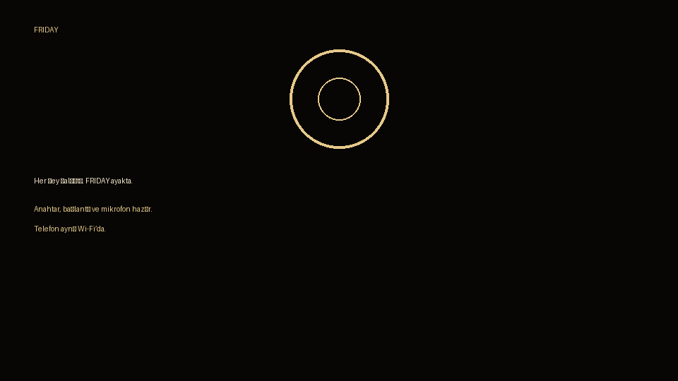

# FRIDAY

Windows için Türkçe sesli asistan. Gemini Live ile konuşur; takvim, anımsatıcı, hava, dosya, uygulama, Spotify, YouTube, ekran ve kamera araçlarını kullanır. Arkadaşının bilgisayarına Python kurmadan kurulur. Telefon, aynı Wi-Fi üzerinden bilgisayara komut ve mikrofon gönderir.

Kurulum dosyası `dist/FRIDAY-Kurulum.exe` dosyasıdır. Bu depoda yoktur; kaynak koddan Inno Setup ile üretilir. Anahtar, telefon jetonu ve kişisel kayıtlar depoya girmez.


## Kurulum

1. `FRIDAY-Kurulum.exe` dosyasını çalıştır. Yönetici sormaz. Uygulama `%LOCALAPPDATA%\FRIDAY` altına kurulur.
2. Masaüstüne ve Başlat menüsüne **FRIDAY** kısayolu gelir.
3. Kurulum, Microsoft Edge WebView2 yoksa sessizce evergreen kurucusunu indirir. Windows 11’de çoğu zaman zaten vardır.
4. Python, depo klonu veya sanal ortam gerekmez.

## İlk açılış

Anahtar yoksa FRIDAY seni karşılar ve Gemini anahtarı ister:

https://aistudio.google.com/apikey

Anahtar kaydedilmeden ses oturumu ve telefon sunucusu başlamaz. Anahtar yalnızca bu bilgisayardaki veri klasöründe durur. Sohbete, günlüğe veya ekran görüntüsüne yazılmaz.

Kayıttan sonra bağlantı, mikrofon ve aynı Wi-Fi telefon köprüsü ayağa kalkar. Ekranda şu cümle görünür:

**Her şey çalıştı. FRIDAY ayakta.**

Anahtar zaten duruyorsa karşılama atlanır.




## Kısayollar

- Yazı kutusuna yazıp Enter.
- F4 mikrofon, F6 kamera, Esc kapatır.
- Ayarlar › Genel › **Windows ile başla** kapalı gelir. Açınca `FRIDAY.exe` kullanıcının kendi Run anahtarına yazılır. Kapatmak veya kaldırmak bu kaydı siler.
- Ayarlar › Ses › **Yankı engelleme** açıktır. Hoparlör yankısı ve konuşma sırasındaki ortam gürültüsü mikrofona gitmeden önce süzülür.

## Telefon

Bilgisayar ve telefon aynı Wi-Fi’da olmalıdır. İnternete tünel açılmaz.

1. Ayarlar › Telefon’daki QR kodu okut.
2. Açılan sayfa `FRIDAY.apk` indirme bağlantısı ve tarayıcıda açma bağlantısı verir.
3. Telefondaki mikrofon bilgisayara PCM olarak gider. Asistanın sesi telefonda duyulur.
4. “Bilgisayarda aç” veya “bilgisayara ilet” dersen komut bilgisayarda çalışır.

`phone-android` bir WebView projesidir (`com.friday.phone`). Android SDK bu makinede yoksa APK üretilmez; tarayıcı sayfası aynı işi görür. SDK varsa `gradlew assembleDebug` çıktısını `phone-android/FRIDAY.apk` olarak koy. Sunucu bu dosyayı `/friday.apk` adresinden verir.

QR ve sayfa adresi bir eşleştirme jetonu taşır. Paylaşma. Ayarlar’dan yeni kod üretmek eskisini düşürür.

## Geliştirme

```
.venv\Scripts\python.exe -m jarvis
.venv\Scripts\python.exe -m unittest discover -s tests -v
.venv\Scripts\python.exe -m PyInstaller --noconfirm --distpath dist --workpath build packaging\friday.spec
```

Kurulum betiği `packaging/friday.iss`. Derlemek için Inno Setup 6 gerekir. Betik `data` klasörünü pakete koymaz; bu yüzden bir bilgisayarın anahtarı başka bir kuruluma gitmez. Yeniden kurulum, kullanıcının duran veri klasörünü silmez.
