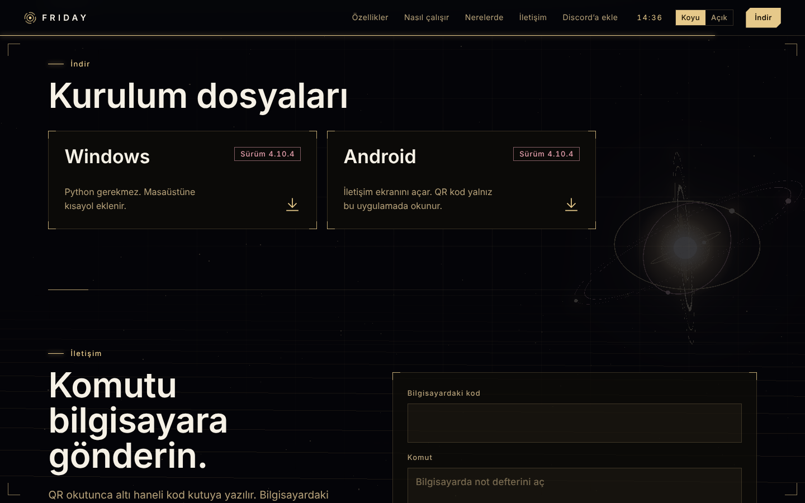
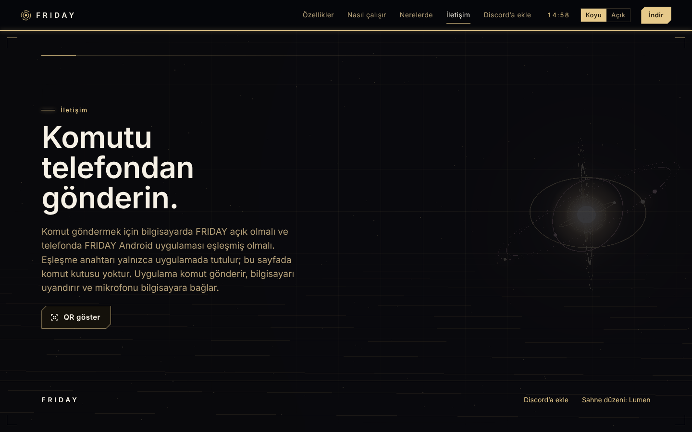

# FRIDAY

Windows için Türkçe sesli asistan. Gemini Live ile konuşur; takvim, anımsatıcı, not, zamanlayıcı, hava, dosya, uygulama, e-posta, WhatsApp, Spotify, YouTube, ekran ve kamera araçlarını kullanır. Python kurmadan kurulur. Android uygulaması bilgisayara komut, Wake-on-LAN ve mikrofon gönderir.

Kurulum dosyası `dist/FRIDAY-Kurulum.exe` dosyasıdır. Bu depoda yoktur; kaynak koddan Inno Setup ile üretilir. Anahtar, telefon jetonu ve kişisel kayıtlar depoya girmez.


## Kurulum

1. `FRIDAY-Kurulum.exe` dosyasını çalıştır. Yönetici sormaz. Uygulama `%LOCALAPPDATA%\FRIDAY` altına kurulur.
2. Masaüstüne ve Başlat menüsüne **FRIDAY** kısayolu gelir.
3. Kurulum, Microsoft Edge WebView2 yoksa sessizce evergreen kurucusunu indirir. Windows 11’de çoğu zaman zaten vardır.
4. Python, depo klonu veya sanal ortam gerekmez.

## İlk açılış

Anahtar yoksa FRIDAY seni karşılar ve Gemini anahtarı ister:

https://aistudio.google.com/apikey

Anahtar kaydedilmeden ses oturumu ve telefon sunucusu başlamaz. Anahtar yalnızca bu bilgisayardaki veri klasöründe durur. Sohbete, günlüğe veya ekran görüntüsüne yazılmaz.

Kayıttan sonra bağlantı, mikrofon ve aynı Wi-Fi telefon köprüsü ayağa kalkar. Ekranda şu cümle görünür:

**Her şey çalıştı. FRIDAY ayakta.**

Anahtar zaten duruyorsa karşılama atlanır.





## Kısayollar

- Yazı kutusuna yazıp Enter.
- F4 mikrofon (uyku modunu da açar/kapatır), F6 kamera, Esc kapatır.
- “Uyku moduna geç” demek veya uyku düğmesi dinlemeyi durdurur.
- Ayarlar › Genel › **Windows ile başla** kapalı gelir. Açınca `FRIDAY.exe` kullanıcının kendi Run anahtarına yazılır. Kapatmak veya kaldırmak bu kaydı siler.

## Neler yapar

- **E-posta:** Gmail’i uygulama şifresiyle arka planda gönderir (Ayarlar’da **Test maili gönder** düğmesi var). Gmail/Outlook web, klasik Outlook ve taslak (mailto) yolları da vardır. Göndermeden önce her zaman sesli “Göndereyim mi?” onayı istenir.
- **WhatsApp:** mesajı hazırlar, onayından sonra gönderir.
- **Notlar** (silinebilir, asistan okuyabilir), **zamanlayıcı ve kronometre** (süre bitince alarm çalar, süre eklenebilir).
- **Ses:** Spotify, uygulama ve sistem sesi komutla değişir. Hızlı konuşmaya karşı sabırlı dinleme ayarlıdır. Açılış ve kapanış sesleri vardır, isteğe bağlı arka plan müziği açılabilir.
- **Masaüstü komutları:** “masaüstünü göster”, “pencereleri küçült”, “ekranı kilitle”, “ekran görüntüsü al”. “Uyu”, “iyi geceler” gibi sözler uyku moduna alır.
- **Müzik varken dinleme:** sürekli çalan müzik ortam sayılır, konuşma müziğin üstünden algılanır (Ayarlar’dan kapatılabilir: `mic_gate`).
- **Arayüz:** paneller 3B eğilir, düğmeler basılınca çöker, hava ikonu hareketlidir. Pencere düğmeleri sağ üstte. Android’de kartlar ve düğmeler dokunuşla eğilir.
- **Güvenlik:** PowerShell’de salt okunur olmayan komutlar onay olmadan çalışmaz.
- **Güncelleme:** uygulama sitedeki `surum.txt` ile sürümü karşılaştırır.

## Telefon

Android uygulaması Jetpack Compose ile yazılmıştır (`com.friday.phone`). İki ayrı QR vardır:

1. Ayarlar › Telefon › **Telefona indir** QR’ı telefonun tarayıcısını sitedeki indirme bölümüne (`#indir`) götürür; APK oradan alınır.
2. **Kapı** QR’ı yalnızca FRIDAY Android uygulamasının içinde okunur ve eşleştirme yapar. Telefon kamerası veya tarayıcı ile açılmaz.

Uygulama komut gönderir, bilgisayarı Wake-on-LAN ile uyandırır, aynı Wi-Fi’da mikrofon köprüsü kurar ve komut geçmişini tutar (düzenle, sabitle, sil). Aynı Wi-Fi dışında `gate` klasöründeki kapı kullanılır; bilgisayar sunucuya kendisi bağlanır. Site ve Discord botu (`!f komut`) aynı kuyruğa yazar.

Ayarlar’daki **Yenile** düğmesi onayla yeni kapı anahtarı üretir, eskisi düşer. QR ve anahtarı paylaşma. Kapı anahtarı ve Discord tokeni depoya girmez; yalnızca `gate/.env.example` vardır. Atrium botuna dokunulmaz.

## Geliştirme

```
.venv\Scripts\python.exe -m jarvis
.venv\Scripts\python.exe -m unittest discover -s tests -v
python tools/bump_version.py X.Y.Z
```

Testler Linux’ta da çalışır; Windows, ağ veya gerçek API gerektirenler `tests/_env.py` işaretleriyle atlanır (canlı Gemini testi için `FRIDAY_TEST_GEMINI_KEY`). `bump_version.py` sürümü Python paketine, Inno Setup betiğine, Android `build.gradle` ve siteye yazar; `surum.txt`’ye dokunmaz.

### Yayın

`yayin` dalına push, `.github/workflows/release.yml` iş akışını çalıştırır: testler, PyInstaller + Inno Setup (`FRIDAY-Kurulum.exe`), Android APK, Vercel’e tek seferde dağıtım (`surum.txt` ile birlikte) ve canlı doğrulama. Sonuç `ci-status` dalındaki `latest.json` dosyasına yazılır. Depo sırları: `VERCEL_TOKEN` (veya `VERCEL`) ve `ANDROID_DEBUG_KEYSTORE_B64`. Sırlar yalnızca GitHub’daki depo ayarlarına girilir.

Elle derlemek için: `python -m PyInstaller --noconfirm --distpath dist --workpath build packaging\friday.spec`, ardından Inno Setup 6 ile `packaging/friday.iss` (UTF-8, BOM’lu kalmalı). Betik `data` klasörünü pakete koymaz; bir bilgisayarın anahtarı başka kuruluma gitmez. Yeniden kurulum kullanıcının veri klasörünü silmez.
